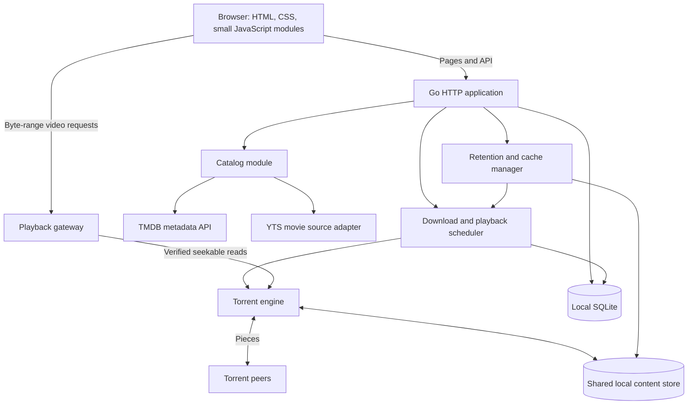

# Bigflix — finalized architecture

Status: architecture baseline finalized on 2026-09-25. Implementation is underway; see README.md and TASKS.md for delivered behavior and validation limits.

## Product scope

Build a local movie browser/player first, with local downloading, persistent caching, and playback while downloading. Later, enable home-network access for approximately 10 users and evaluate the QNAP TS-435XeU. Ten users does not imply verified capacity for ten simultaneous streams.

First implementation priority is catalog and source discovery. Movies use the supplied YTS-compatible API. Worldwide discovery and release metadata use TMDB. TV playback and other media providers remain planned extensions.

## Fixed decisions

| Area | Decision |
| --- | --- |
| Application | One Go process, organized into internal modules |
| Web interface | Go html/template, CSS, small vanilla JavaScript modules, native HTML video |
| Build/runtime | Go build and one application executable with embedded templates/static assets; no React, Node.js, or frontend build pipeline |
| HTTP | Go net/http, same-origin pages/API/media routes |
| Live updates | Server-sent events for download/buffering status; ordinary HTTP for commands |
| Persistence | SQLite, migrations, local database file; select a maintained pure-Go driver during dependency validation |
| Movie sources | Configurable YTS-compatible API base: https://movies-api.accel.li/api/v2/ |
| Trending/releases | TMDB through a Go metadata adapter; backend-only credentials and required attribution |
| Torrent engine | anacrolix/torrent behind an internal interface; mandatory scheduling/streaming validation gate |
| Storage | One shared on-disk content store for partial, complete, cached, and kept media |
| Jobs | Bounded in-process workers; persisted desired state and restart recovery |
| Initial playback | Direct play of H.264/AAC MP4, validated in current Chrome and Safari on the development PC |
| Conversion | Deferred optional FFmpeg/ffprobe integration; not required for the initial executable |
| Deployment | Loopback-only PC first; authenticated LAN access and NAS evaluation later |

Minimal JavaScript handles player events, watch progress, and SSE updates. Go renders pages and owns all business logic. Native video controls remain usable without the richer UI behavior.

## Component relationships

All internal boxes run in the Go application. No qBittorrent service, external queue, Redis, or separate frontend server is required.

## Catalog and source discovery — first milestone

### YTS movie source

A read-only request to list_movies.json?limit=1 succeeded during this session with status ok. Observed fields included movie ID, IMDb ID, title/year, descriptions, posters, genres, torrent URL/hash, codec, quality, size, and reported seeds/peers. This validates one list response, not every endpoint, source availability, operator identity, or playback.

Use the API instead of scraping HTML. Validate search, pagination, details, sorting, and failure responses before relying on them. Store provider IDs independently of our internal IDs. Match to TMDB using IMDb identifiers where possible; title/year fallback must surface ambiguous results. Source-reported quality and peer counts are hints, not verified playback guarantees.

Fetch sources on demand and cache metadata with timestamps. Initial operational defaults: 15-minute source-result cache, bounded requests, at most two concurrent calls per provider, and backoff on throttling. These are application defaults, not claims about provider limits. Serve stale cached data with an explicit freshness label on upstream failure.

### Trending and new releases

Use TMDB day/week trends as a worldwide discovery feed across languages; label the data source so the UI does not claim a universal audience ranking. Keep display language separate from origin-country filters.

Initial shelves:

- Trending Today and Trending This Week: movies, from TMDB.
- New Releases: movies with a primary release date in the last 30 days, excluding future dates; this is not a claim of digital availability in every country.
- Recently Added to YTS: source upload date, separate from release date.
- Downloads, Continue Watching, and Kept Movies: local application state.

Default catalog feed refresh is hourly; title metadata can cache for 24 hours. TMDB configuration is needed to deliver trending/release shelves. Without its credential, YTS browsing still works but those shelves show an explicit configuration state; do not replace them with fabricated trends. More detailed regional theatrical/digital release filters and TV catalog shelves follow later.

### Extensibility

Keep catalog metadata separate from source discovery and source resolution. Define provider capabilities without implementing every transport now. Later adapters may return torrents, direct HTTP files, or unprotected HLS/DASH manifests. A player-page URL is not a media URL. Site-specific scrapers and yt-dlp are not first-release dependencies.

## Download and playback pipeline

1. User opens a movie and chooses a source variant and Watch now or Keep downloaded.
2. Go resolves the torrent, checks identity/path validity, selects the main video (or asks the user if ambiguous), and maps file offsets to pieces.
3. Scheduler prefers ascending piece order for background downloading. Metadata and active playback windows have higher priority.
4. Gateway waits for verified required bytes and an initial read-ahead buffer, then serves HTTP range responses to the browser.
5. Seeking updates that session's desired range. Old requests are canceled or demoted. The player buffers if requested bytes are not yet available.
6. Concurrent viewers share downloaded data but maintain separate playback windows. Scheduler applies fairness and bounded resource use.
7. On restart, the engine restores jobs and validates cached piece state before reporting readiness.

Sequential is a preferred request order, not a guarantee that network responses finish in order. Container metadata may live near the end of a file. The gateway must never expose missing sparse-file bytes as valid video.

Use deadlines and request cancellation for missing data. Before headers are sent, return a clear retryable error when appropriate; after a stream has begun, terminate cleanly and let the player retry. Handle HEAD, normal/suffix ranges, invalid ranges, end-of-file, concurrent requests, and reader cleanup.

### Mandatory implementation gate

The architecture selects anacrolix/torrent for the first validation experiment; it does not assert that default readers implement the desired scheduling policy. Verify public APIs for sequential background priority, read-ahead, metadata priority, cancellation, seek reprioritization, multi-viewer fairness, and persistent storage.

Use a controlled local seeder and known test videos. Measure piece order and demonstrate playback before completion. If essential behavior cannot be implemented with the public API, stop and revise the engine decision before building on it.

Startup depends on peer availability, download throughput, bitrate, and file layout. Unsupported codecs produce a clear message and a download-only option. Broad codec support and transcoding are later work.

## Local download and cache policy

Watch now and Keep downloaded are retention policies over the same content, not separate copies.

| Mode | Download behavior | Retention |
| --- | --- | --- |
| Watch now | Download for playback and continue toward completion in the background while resources allow | Evictable after sessions/jobs release their storage leases |
| Keep downloaded | Queue full selected-video download, regardless of whether it is being watched | Excluded from automatic cache eviction; explicit deletion only |

Changing a cached movie to Keep only changes metadata. Clearing Keep makes it eviction-eligible; it does not immediately delete it. Pause retains partial data. Removal coordinates with readers and the torrent engine before deleting bytes.

Storage layout:

    data/bigflix.db
    data/torrent-state/
    media/torrents/<content-key>/...

Canonical torrent identity deduplicates jobs and storage. Piece boundaries may overlap adjacent files; preserve the engine's required storage layout. Multi-file eviction operates on the torrent content unit in v1, and any kept file protects that unit. Report the resulting retained disk usage honestly.

Initial configurable policy defaults:

- Temporary cache target: 50 GB, measured from actual allocated storage where supported.
- Disk free-space reserve: 10 GB. Kept downloads still consume real disk space and obey admission/free-space checks.
- Prefer evicting least-recently-accessed eligible content. Never delete an active playback lease, kept content, or active write.
- Pause idle background jobs and release leases before eviction. If no safe space can be freed, stop admitting work and show a storage-full state; do not violate protections.
- Recheck disk space during downloads and handle disk-full errors. Cache limits are targets subject to filesystem allocation and active-stream constraints, not permission for unlimited growth.
- Default: no idle seeding after download completion. Uploading may occur while a torrent is active for downloading or playback. Make bandwidth and retention/seeding settings visible.

Keep SQLite on local application storage even if media later moves to a NAS share. Back up application metadata separately from media.

## Data model and modules

Core records: movies and external IDs, source variants, torrent jobs, selected files, playback sessions, retention policy, per-profile watch progress, feed snapshots, provider health, and settings. Add users/sessions for the LAN milestone.

Track download state independently from playback state: downloading can coexist with playing or buffering. Distinguish selected-video completion from whole-torrent completion. Persist desired state; recalculate transient peer counts and throughput after restart.

Suggested source layout:

    cmd/bigflix/
    internal/web/          # handlers, templates, static assets
    internal/catalog/     # feeds, identity matching, metadata
    internal/providers/   # YTS and TMDB adapters
    internal/downloads/   # jobs and scheduling
    internal/torrent/     # engine interface and implementation
    internal/playback/    # readers, ranges, playback sessions
    internal/storage/     # retention, disk accounting, leases
    internal/database/    # schema and migrations
    internal/config/

## Local access and later deployment

The initial app uses one local profile and binds to 127.0.0.1. Validate Host/Origin and protect state-changing requests. Treat remote metadata as untrusted: escape templates, validate URLs and redirects, block remote fetches into local/private networks, bound response sizes, and constrain torrent paths/symlinks to the content root. Validate fetched torrent identity against the selected source.

Before LAN exposure, add login, session security, per-user progress, authorization on media/events/API routes, and administrator-only provider/storage configuration. Load-test multiple viewers separately for cached playback and active downloads. No router forwarding or public deployment is planned.

NAS migration is an evaluation milestone, not a dependency of local development. Check ARM64 dependencies, memory, disk/network performance, permissions, restart behavior, and storage disconnections. The eventual host placement may keep Go or optional conversion on the PC with NAS-backed media.

## Delivery order

1. Go pages and database; YTS browsing/search/quality variants; TMDB trends/releases.
2. Controlled torrent experiment for sequential downloading, in-progress playback, seeking, and restart recovery.
3. Connect catalog selections to local downloads, player, watch progress, and retention policies.
4. Cache pressure/recovery tests and a complete local release.
5. Accounts and LAN pilot; optional conversion, TV/other providers; NAS evaluation as separate extensions.

## References

- User-supplied, list endpoint verified: https://movies-api.accel.li/api/v2/
- TMDB trends: https://developer.themoviedb.org/reference/trending-all
- TMDB region semantics: https://developer.themoviedb.org/docs/region-support
- TMDB attribution: https://developer.themoviedb.org/docs/faq
- Torrent reader implementation: https://github.com/anacrolix/torrent/blob/master/reader.go

Provider availability and dependency behavior must be checked during implementation. No current uncertainty authorizes quietly changing the agreed language, frontend approach, or product scope.

## Current implementation delta

The local catalog and first torrent playback path are implemented. The engine uses verified readers, 4 MiB ascending background windows, head/tail priority, and 8 MiB reader lookahead. Controlled transfer/restart tests and generated-video browser playback passed. Current storage protection is a conservative total selected-video budget including kept content, plus the free-space reserve. Automatic eviction, separate temporary/kept budget accounting, a removal UI, and periodic catalog refresh are not yet implemented. Torrent discovery currently uses DHT/PEX; no remote trackers or webseeds are requested. Broader compatibility and household load targets are still unverified.
